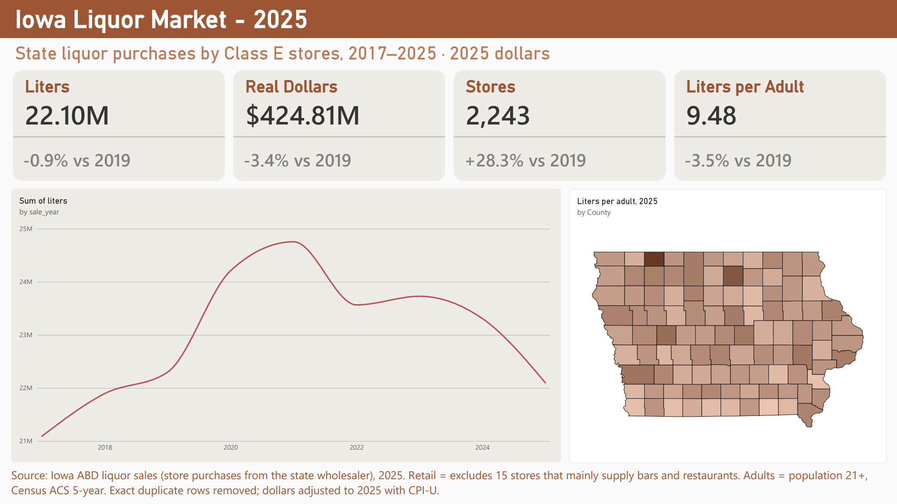
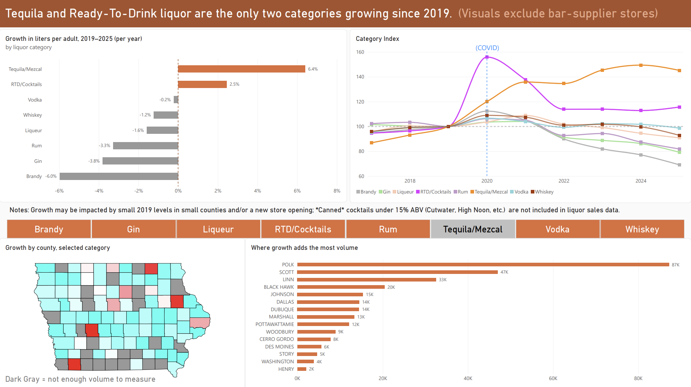
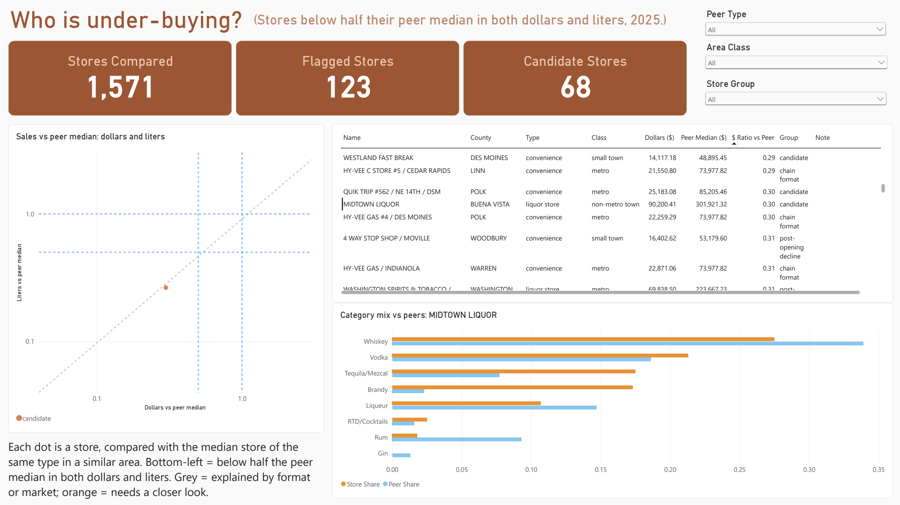
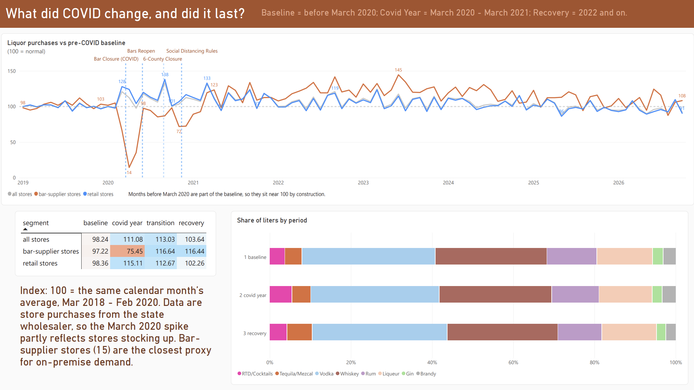
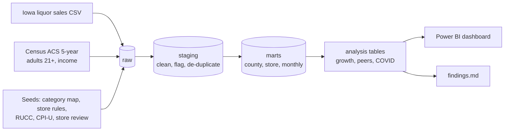

# Iowa Liquor Market Analysis Project

This is an end-to-end analysis (ingestion &rarr; cleaning &rarr; modeling &rarr; analysis &rarr; dashboard) of Iowa's state liquor purchase records (2017–2026), joined with Census population and income data, to answer three questions a spirits distributor might ask:

1. **Where is demand growing?** Which spirit families are gaining per adult, and in which counties?
2. **Which stores under-buy?** Which stores buy far less than comparable stores, and why?
3. **What did COVID change?** What shifted in 2020, and did it last?

**Stack:** PostgreSQL 17 (Docker), SQL, Power BI (DAX), Census ACS, USDA RUCC, BLS CPI-U

**[Findings](docs/findings.md) - [Data-quality log](docs/data_quality_log.md) - [Dashboard file](dashboard/iowa-liquor.pbix)**



## Key findings

- **Tequila is the only major spirit family growing per adult:** +5.8% a year from 2019 to 2025 statewide (+6.4% at retail stores), and +4.6% in the median county, so the growth is broad rather than driven by a few places. Vodka is flat; whiskey, liqueur, rum, gin and brandy are shrinking.
- **Existing stores are losing volume almost everywhere.** Among stores open all year in both 2019 and 2025, sales fell in 81 of 97 counties, including every large metro except Scott. County totals held up mainly because new stores opened. The clearest case is Clinton County: its apparent near-doubling comes from one store that opened in 2020, while the county's established stores fell 19%.
- **15 stores that appear to supply bars sell about 11% of Iowa's liquor** and distort county comparisons. They were identified from their bottle-size mix (mostly 1 L bottles). Excluding them moves Clinton from 2nd to 41st in liters per adult, and drops Polk, Linn and Black Hawk out of the top 10.
- **123 established stores buy less than half of what comparable stores buy.** 55 of them are explained by chain format, price position, a recent opening or a saturated local market. The remaining 68 candidates would add about $0.9M a year just to reach half their peer median. Crowded markets turned out to matter more than under-stocked shelves.
- **COVID split the market in two.** In April 2020, bar-supplier stores bought 86% less than a normal April while retail stores bought 24% more. The at-home surge has faded (retail was back to normal by 2025). Ready-to-drink cocktails were the one category COVID clearly boosted, and they gave most of it back.

## Dashboard

Handmade because Copilot is not available for personal PowerBI accounts. Includes four pages, in PowerBI, each answering one question. The full numbers behind every chart are in [docs/findings.md](docs/findings.md).

| Page | What it shows |
|---|---|
| **Overview** | 2025 snapshot: sales, stores, and retail liters per adult by county |
| **Growth** | Growth rate by spirit family, a county map for the selected family, and the counties adding the most volume |
| **Peers** | Every store's sales against its peer median, why each low store is low, and its category mix vs peers |
| **COVID** | Monthly purchases against a pre-COVID baseline for retail and bar-supplier stores, with Iowa's 2020 restriction dates |

| Growth | Peers | COVID |
|---|---|---|
|  |  |  |

## Data cleaning highlights

I got the raw data from Iowa API, so I had to clean it myself. Every issue is logged with counts, the decision taken and the reason in the [data-quality log](docs/data_quality_log.md). The ones that changed results:

- **1.9M exact duplicate rows**, identical in all 23 columns, concentrated in 2020–22 and mid-2025. Removing them brings totals in line with the Alcoholic Beverages Division's published fiscal-year sales (FY2021: \$417.1M after cleaning vs \$415.8M published). Duplicates are flagged, not deleted, and the marts read from a de-duplicated view.
- **Missing volumes in 2025–26.** Liters were recorded as zero for many recent rows, so they are derived from bottle size × bottles sold, and returns are flagged separately.
- **Mini-bottle multipacks** (14% of 2025 rows) are recorded as single 50 ml bottles, which understates liters and inflates price per liter. They are flagged, and store comparisons use dollars alongside liters.
- **Misfiled products.** Flavored Crown Royal and several budget agave spirits sit in catch-all categories, which inflates "Other" and likely understates tequila's growth. The headline is conservative as a result.

## How it works



- **Staging** cleans types, standardizes categories and store names (seeded mappings), fixes store ZIP codes and matches them to Census ZIP code tabulation areas (ZCTAs), and adds flags (duplicates, returns, multipacks, bad volume) instead of deleting rows.
- **Marts** aggregate to county × year, county × category × year, store × year and month. They add per-adult rates (Census adults 21+), real dollars (CPI-U) and rural/urban codes (USDA RUCC).
- **Analysis** uses compound growth rates on liters per adult, same-store growth, peer medians with `percentile_cont` and `NTILE` income terciles, and a seasonally matched COVID index (each month against the same month in March 2018 – February 2020).
- **Power BI** uses a star schema with a shared year dimension, DAX measures, and a county Shape map built from Census boundary files.

### Key definitions

| Term | Meaning |
|---|---|
| Liters per adult | Liters purchased ÷ county population aged 21+ (ACS 5-year) |
| Retail | All stores except the 15 bar-supplier-profile stores |
| Bar-supplier profile | At least 60% of bottles are 1 L, under 10% are handles, under 10% are minis, and the store sells at least 20,000 L per active year |
| Peer group | Same store type × town size (by the store's ZIP area) × local income tercile |
| Under-buying | Below half the peer median in both liters and dollars, open since 2023 or earlier, in a peer group of at least 10 stores |

## How to reproduce it

Requirements: Docker, Bash (Linux, macOS or WSL2) with `curl` and `unzip`, Python 3, a free [Census API key](https://api.census.gov/data/key_signup.html), and about 12 GB of free disk space.

```bash
git clone <repo-url> && cd iowa-liquor
cp .env.example .env          # set a database password and your Census API key
./scripts/build_all.sh
```

`build_all.sh` runs every step in order: it starts Postgres, downloads each year of sales from the Iowa Data Hub, loads them into the raw schema, pulls Census ACS data, then builds staging, marts and analysis tables. Might take about 30 minutes or so, mostly downloading and loading. Then open `dashboard/iowa-liquor.pbix` in Power BI Desktop, point the PostgreSQL connection at `localhost`, and click Refresh.

To rebuild only the SQL layers after a change (no downloads):

```bash
./scripts/run_sql.sh sql/10_staging/*.sql sql/20_marts/*.sql sql/analysis/*.sql
```

## Repo map

```
├── docker-compose.yml     Postgres 17 container
├── .env.example           settings to copy into .env (database, Census API key)
├── requirements.txt       Python packages for the Census download
├── ingest/                Census ACS download, raw-table generator, connection helpers
├── scripts/
│   ├── build_all.sh       full rebuild from scratch
│   ├── download_sales.sh  yearly sales files from the Iowa Data Hub
│   └── run_sql.sh         runs SQL files in order
├── seeds/                 hand-built lookups: category map, store-type rules, RUCC, CPI-U, store review
├── sql/
│   ├── 00–01_*.sql        schemas, raw sales table
│   ├── 10_staging/        cleaning, flags, de-duplicated view
│   ├── 20_marts/          county, store and monthly tables
│   ├── analysis/          a* growth, b* peer benchmarking, c* COVID
│   └── profiling/         investigative sql queries
├── dashboard/             Power BI file and screenshots
├── docs/                  findings and data-quality log
└── data/                  downloads (not in Git)
```

## Limitations

- **The data does not measure consumption.** The data records what stores buy from the state wholesaler, by store location. Stockpiling, tourism and cross-border shopping all show up where the store is.
- **Bar-supplier stores are inferred** from bottle mix (i.e., stores heavy on 1L bottles). The data doesn't record who the buyer is.
- **Spirits only. No *canned* cocktails.** Since 2019, canned cocktails up to 15% ABV are distributed as beer in Iowa and aren't in this data.
- **Growth rates use two endpoints** (2019 and 2025), and small counties can swing on one store opening.

## Hypothetical follow-up work

- Remap the largest misfiled products to their natural family and rerun the growth analysis.
- Split statewide change into existing, new and closed stores, to measure how much of the market new outlets take.
- Build a same-store version of the COVID index, to separate bar-channel recovery from new stores.
- Add automated data tests (row counts, duplicate checks, reconciliation to published totals) to the rebuild.

## Data sources

- **Iowa Liquor Sales:** Iowa Department of Revenue, Alcoholic Beverages Division, one dataset per year on the [Iowa Data Hub](https://catalog.data.gov/dataset/iowa-liquor-sales-2026) (data.iowa.gov moved there in June 2026)
- **American Community Survey 5-year estimates:** U.S. Census Bureau (population 21+, median household income by ZCTA and county)
- **Rural-Urban Continuum Codes:** USDA Economic Research Service
- **CPI-U annual averages:** U.S. Bureau of Labor Statistics
- **County boundaries:** Census cartographic boundary files

<!-- Data belongs to its publishers. -->